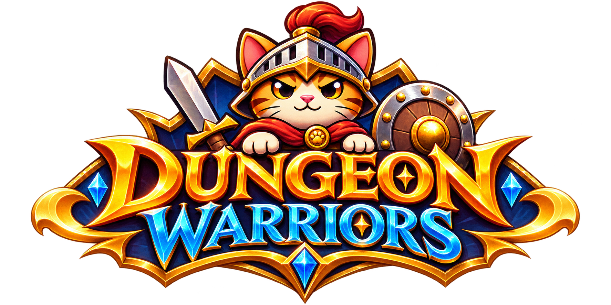
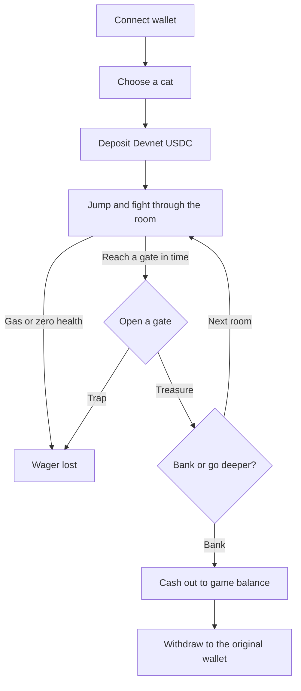
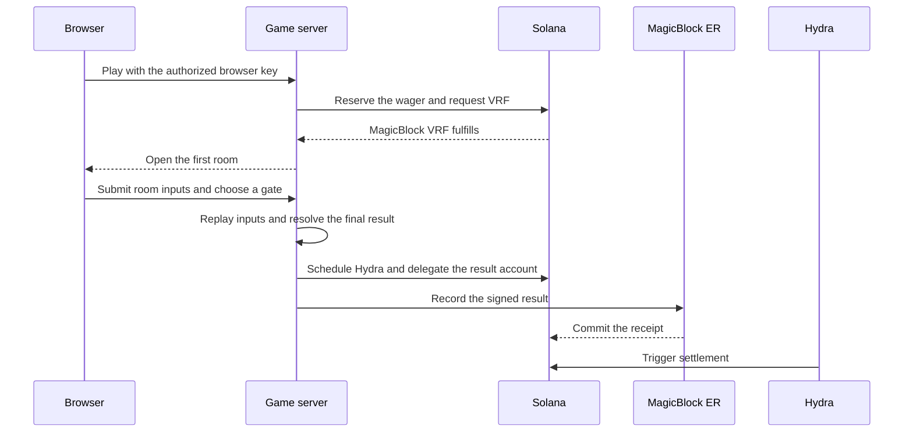

<p align="center">
  
</p>
<h1 align="center">Dungeon Warriors</h1>
<p align="center">
  <a href="https://www.dungeonwarriors.xyz"></a>
  <a href="#devnet-playthrough"></a>
</p>

## About

A wagered cat dungeon crawler on Solana Devnet.<br>
Fight through timed rooms, pick a gate, and bank your treasure or go deeper.

## How to play

Claim a starter cat or open a capsule to add to your onchain collection. Deposit test USDC to enable browser-signed play and withdrawals. Explore up to five rooms, each with two treasure gates and one trap.



## Built with

| Technology | Role |
| --- | --- |
| <a href="https://solana.com/"></a> | Anchor program for cat ownership, USDC custody, wagers, and payouts. |
| <a href="https://www.magicblock.xyz/"><picture><source media="(prefers-color-scheme: dark)" srcset="https://www.magicblock.xyz/assets/magicblock-logotype-white.png"></picture></a> | VRF supplies randomness for runs and capsule draws. Ephemeral Rollups record terminal results, and Hydra triggers settlement. |
| **Next.js and Phaser** | The browser runs movement and combat. The server replays submitted inputs before signing the result. |

### Wager and settlement



## Devnet programs and treasury

| Program | Address |
| --- | --- |
| Dungeon Warriors | [`F1cmavHq4562uJ8JmRPM5oFk8q28GW5hadXnZfVCCcUx`](https://explorer.solana.com/address/F1cmavHq4562uJ8JmRPM5oFk8q28GW5hadXnZfVCCcUx?cluster=devnet) |
| MagicBlock VRF | [`Vrf1RNUjXmQGjmQrQLvJHs9SNkvDJEsRVFPkfSQUwGz`](https://explorer.solana.com/address/Vrf1RNUjXmQGjmQrQLvJHs9SNkvDJEsRVFPkfSQUwGz?cluster=devnet) |
| MagicBlock Delegation | [`DELeGGvXpWV2fqJUhqcF5ZSYMS4JTLjteaAMARRSaeSh`](https://explorer.solana.com/address/DELeGGvXpWV2fqJUhqcF5ZSYMS4JTLjteaAMARRSaeSh?cluster=devnet) |
| MagicBlock Magic Program (ER) | `Magic11111111111111111111111111111111111111` |
| MagicBlock Hydra | [`Hydra17i1feui9deaxu6d1TzSQMRNHeBRkDR1Awy7zea`](https://explorer.solana.com/address/Hydra17i1feui9deaxu6d1TzSQMRNHeBRkDR1Awy7zea?cluster=devnet) |
| SPL Token | [`TokenkegQfeZyiNwAJbNbGKPFXCWuBvf9Ss623VQ5DA`](https://explorer.solana.com/address/TokenkegQfeZyiNwAJbNbGKPFXCWuBvf9Ss623VQ5DA?cluster=devnet) |
| Associated Token Account | [`ATokenGPvbdGVxr1b2hvZbsiqW5xWH25efTNsLJA8knL`](https://explorer.solana.com/address/ATokenGPvbdGVxr1b2hvZbsiqW5xWH25efTNsLJA8knL?cluster=devnet) |

| Treasury account | Address |
| --- | --- |
| House PDA (vault authority) | [`6SGX1JZ1zmuVbPJmFHPmaGasUwoTHoa5WZDBjwuf19C5`](https://explorer.solana.com/address/6SGX1JZ1zmuVbPJmFHPmaGasUwoTHoa5WZDBjwuf19C5?cluster=devnet) |
| USDC vault | [`G68pmVi6n7cA1LPFvtP3JfCqJc7MAZzsiyuoCrGodLNh`](https://explorer.solana.com/address/G68pmVi6n7cA1LPFvtP3JfCqJc7MAZzsiyuoCrGodLNh?cluster=devnet) |
| Devnet USDC mint | [`4zMMC9srt5Ri5X14GAgXhaHii3GnPAEERYPJgZJDncDU`](https://explorer.solana.com/address/4zMMC9srt5Ri5X14GAgXhaHii3GnPAEERYPJgZJDncDU?cluster=devnet) |

## Devnet playthrough

A live test run cleared room 1 and paid **0.001425 USDC** on a **0.001 USDC** wager.

[Wager reservation](https://explorer.solana.com/tx/4C2FJBcgLQ1z8z9KBvfibFhtBHD3TeuP1sY8N7XumkKwToWofozKL548sCWrZZtdYqtUVisxPyCMrew1nMCV9ews?cluster=devnet) · [Hydra settlement](https://explorer.solana.com/tx/4kgG1euS3aJJfXZD7gTxR8RZsGr7osADyhjQTCi1hjLM6mDYR7kLBDBWotKNFRJ911HZJZcd4kj6R7rQFyrx9QeL?cluster=devnet) · [Browser-signed withdrawal](https://explorer.solana.com/tx/3Sf2JYsBGt8jRqGe3LBxpiQhgM8i2vfHEfQw7jLzx2M18WTZwQUJJkjSs5U8pT8oQBnp54s8hAxFX8PpHFbAKUhJ?cluster=devnet)

## Repository

- [Web app and dungeon engine](apps/web)
- [Solana program](apps/dungeon-warriors-program)

Use Node.js 26 and the pnpm version pinned in [package.json](package.json).

```sh
pnpm install --frozen-lockfile
pnpm typecheck
pnpm test:web --maxWorkers=2 --testTimeout=30000
```
