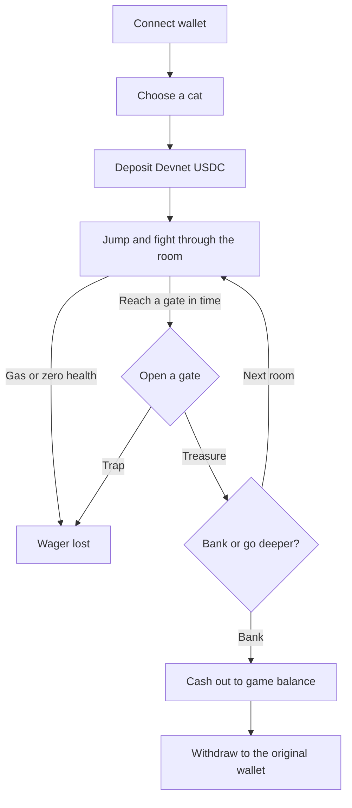
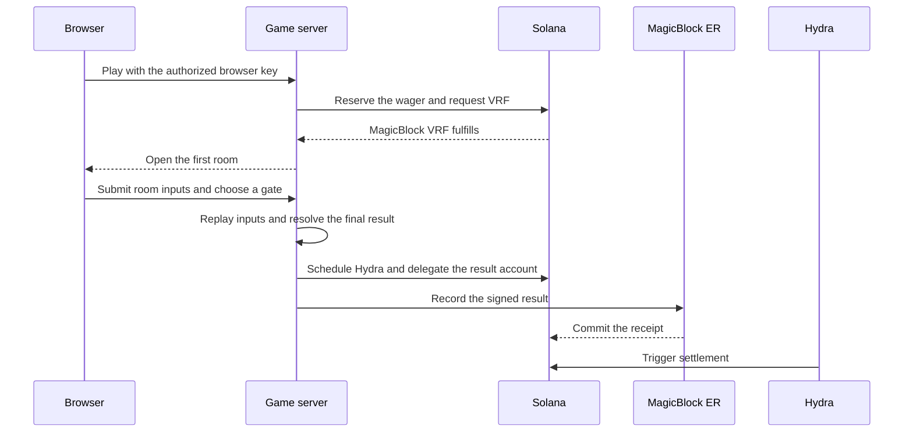

<p align="center">
  
</p>
<h1 align="center">Dungeon Warriors</h1>
<p align="center">
  <a href="https://www.dungeonwarriors.xyz"></a>
  <a href="#how-to-play"></a>
</p>

## About

A wagered cat dungeon crawler on Solana Devnet.<br>
Fight through timed rooms, pick a gate, and bank your treasure or go deeper.

## How to play

Claim a starter cat or open a capsule to add to your onchain collection. Deposit test USDC to enable browser-signed play and withdrawals. Explore up to five rooms, each with two treasure gates and one trap.



## Built with

| Technology | Role |
| --- | --- |
| <a href="https://solana.com/"></a> | Anchor program for cat ownership, USDC custody, wagers, and payouts. |
| <a href="https://www.magicblock.xyz/"><br><strong>MagicBlock</strong></a> | VRF supplies randomness for runs and capsule draws. Ephemeral Rollups record terminal results, and Hydra triggers settlement. |
| **Next.js and Phaser** | The browser runs movement and combat. The server replays submitted inputs before signing the result. |

### Wager and settlement



## Devnet programs and treasury

### Dungeon Warriors program

The Anchor program records cat ownership, manages the USDC vault, reserves wagers, and settles payouts.

| Program | Address |
| --- | --- |
| Dungeon Warriors | [`F1cmavHq4562uJ8JmRPM5oFk8q28GW5hadXnZfVCCcUx`](https://explorer.solana.com/address/F1cmavHq4562uJ8JmRPM5oFk8q28GW5hadXnZfVCCcUx?cluster=devnet) |

### Treasury

| Treasury account | Address |
| --- | --- |
| House PDA (vault authority) | [`6SGX1JZ1zmuVbPJmFHPmaGasUwoTHoa5WZDBjwuf19C5`](https://explorer.solana.com/address/6SGX1JZ1zmuVbPJmFHPmaGasUwoTHoa5WZDBjwuf19C5?cluster=devnet) |
| USDC vault | [`G68pmVi6n7cA1LPFvtP3JfCqJc7MAZzsiyuoCrGodLNh`](https://explorer.solana.com/address/G68pmVi6n7cA1LPFvtP3JfCqJc7MAZzsiyuoCrGodLNh?cluster=devnet) |
| Devnet USDC mint | [`4zMMC9srt5Ri5X14GAgXhaHii3GnPAEERYPJgZJDncDU`](https://explorer.solana.com/address/4zMMC9srt5Ri5X14GAgXhaHii3GnPAEERYPJgZJDncDU?cluster=devnet) |

### Programs used

| Program | Role | Address |
| --- | --- | --- |
| MagicBlock VRF | Randomness for runs and capsule draws | [`Vrf1RNUjXmQGjmQrQLvJHs9SNkvDJEsRVFPkfSQUwGz`](https://explorer.solana.com/address/Vrf1RNUjXmQGjmQrQLvJHs9SNkvDJEsRVFPkfSQUwGz?cluster=devnet) |
| MagicBlock Delegation | Delegates the result account to the rollup | [`DELeGGvXpWV2fqJUhqcF5ZSYMS4JTLjteaAMARRSaeSh`](https://explorer.solana.com/address/DELeGGvXpWV2fqJUhqcF5ZSYMS4JTLjteaAMARRSaeSh?cluster=devnet) |
| MagicBlock Magic Program (ER) | Commits the rollup receipt to Solana | `Magic11111111111111111111111111111111111111` |
| MagicBlock Hydra | Schedules settlement on Solana | [`Hydra17i1feui9deaxu6d1TzSQMRNHeBRkDR1Awy7zea`](https://explorer.solana.com/address/Hydra17i1feui9deaxu6d1TzSQMRNHeBRkDR1Awy7zea?cluster=devnet) |
| SPL Token | Transfers Devnet USDC | [`TokenkegQfeZyiNwAJbNbGKPFXCWuBvf9Ss623VQ5DA`](https://explorer.solana.com/address/TokenkegQfeZyiNwAJbNbGKPFXCWuBvf9Ss623VQ5DA?cluster=devnet) |
| Associated Token Account | Creates standard USDC token accounts | [`ATokenGPvbdGVxr1b2hvZbsiqW5xWH25efTNsLJA8knL`](https://explorer.solana.com/address/ATokenGPvbdGVxr1b2hvZbsiqW5xWH25efTNsLJA8knL?cluster=devnet) |

## Project structure

```text
apps/
├── web/                            Next.js web app
│   ├── app/                        Pages and API routes
│   ├── components/                 Game and lobby UI
│   ├── lib/                        Dungeon engine and server logic
│   └── public/                     Game assets and logos
└── dungeon-warriors-program/       Solana Anchor workspace
    └── programs/dungeon-warriors/  Onchain game program
packages/config/                    Shared TypeScript and Biome configuration
scripts/                            Asset, program, and provider tools
tests/                              Web and program tests
```
